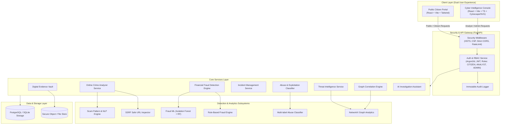

# CYBERSHIELD
## Digital Crime Prevention & Intelligence Platform

> **"Detect. Understand. Protect."**  
> An intelligent, privacy-first cybersecurity platform that helps individuals identify online scams, analyze suspicious digital activity, preserve incident evidence, discover related threat patterns, and take informed action against digital crime.

📖 **[Read the Full Platform Documentation & Operator Manual (DOCUMENTATION.md)](DOCUMENTATION.md)** for exhaustive architectural details, detection logic, and operator credentials.

---

### Core Mission

CYBERSHIELD is a public-interest cybersecurity platform built to counter online crime targeting citizens, job seekers, students, and organizations. The platform provides two distinct, strictly isolated experiences:

1. **Public Citizen Portal** — Accessible, jargon-free, safety-centric interface for scam analysis, zero-trust URL inspection, incident evidence preservation, and authoritative reporting directives.
2. **Cyber Intelligence Console** — Specialized workspace for authorized cybersecurity analysts and administrators featuring NetworkX-driven threat correlation, 3-layer financial fraud analytics, case triage, and immutable audit logs.

Initial geographic alignment emphasizes **India** (integration with the National Cyber Crime Reporting Portal `cybercrime.gov.in`, Financial Cyber Fraud Helpline `1930`, and CERT-In), with an extensible architecture ready for international expansion.

---

## Architecture Diagram



---

## Core Product Modules

| Module | Purpose | Key Engineering Highlights |
|---|---|---|
| **Module 1: Online Crime Analyzer** | Scam messages, fake jobs, and suspicious URLs | Regex heuristics + behavioral urgency scoring + zero-trust SSRF protection (blocks 169.254.169.254, loopbacks, RFC1918) |
| **Module 2: Financial Fraud Engine** | High-velocity UPI / banking fraud detection | 3-Layer architecture: Layer A (Rules), Layer B (Isolation Forest + Random Forest), Layer C (0-100 Risk Aggregator) |
| **Module 3: Online Abuse & Exploitation** | Harassment, cyberstalking, and sextortion detection | Multi-label context-aware classifier; differentiates victim-quoted messages from direct perpetrator threats |
| **Module 4: Threat Intelligence DB** | Structured indicator repository (IOCs) | Defanging, deduplication, provenance tracking, and exponential half-life confidence decay algorithm |
| **Module 5: Graph Correlation Engine** | Correlates syndicates and infrastructure | Python NetworkX graph engine with degree centrality, connected components, and community detection |
| **Module 6: Incident Reporting Portal** | Citizen incident reporting | Unique reference codes (`CS-2026-XXXXX`), anonymous mode, privacy consent controls, and lifecycle triage |
| **Module 7: Digital Evidence Vault** | Forensic integrity preservation | Immediate SHA-256 cryptographic hashing, private isolated object store, and exportable PDF Evidence Assistance Reports |
| **Module 8: Cyber Safety Center** | Public safety education | Actionable threat vector guides (UPI scams, fake jobs, sextortion, electricity scams) + Official 1930 / cybercrime.gov.in links |
| **Module 9: Intelligence Dashboard** | Real-time operations console | Operational metrics calculated from actual database records (no fabricated live statistics) |
| **AI Investigation Assistant** | Case synthesis & timeline generator | Prompt-injection sanitization, deterministic timelines, and structured investigative questions for analysts |

---

## Technology Stack

- **Backend**: Python 3.11, FastAPI, Pydantic v2, SQLAlchemy 2.0, ReportLab, Scikit-learn, NetworkX, NumPy, HTTPX, PyJWT, Argon2-cffi.
- **Frontend**: React 18, TypeScript, Vite, Tailwind CSS, Lucide React, Axios, React Router v6.
- **Database**: PostgreSQL (Production) / SQLite (Zero-config local development and testing).
- **Security & DevSecOps**: Zero-Trust SSRF Socket Layer, Argon2id Password Hashing, Bandit SAST, GitHub Actions CI/CD, Docker Compose.

---

## Quickstart & Local Setup

### Option 1: Docker Compose (Recommended)

```bash
# Clone the repository
git clone https://github.com/your-org/cybershield.git
cd cybershield

# Copy environment variables
cp .env.example .env

# Start full stack (PostgreSQL + Backend + Frontend)
docker compose up --build
```
- Public Citizen Portal: `http://localhost:3000`
- FastAPI Interactive OpenAPI Docs: `http://localhost:8000/api/docs`

### Option 2: Local Development

#### 1. Backend Setup
```bash
# Set up Python 3.11 virtual environment
python3 -m venv backend/venv
source backend/venv/bin/activate

# Install dependencies
pip install -r backend/requirements.txt

# Run migrations and start backend server
PYTHONPATH=. uvicorn backend.app.main:app --reload --port 8000
```

#### 2. Frontend Setup
```bash
cd frontend
npm install
npm run dev
```
Open `http://localhost:5173` in your browser.

---

## Pre-Seeded Demonstration Accounts

For security review and evaluation, the database auto-seeds the following roles:

| Role | Email | Password | Access Capabilities |
|---|---|---|---|
| **Admin** | `admin@cybershield.org` | `CybershieldAdmin2026!` | Full administrative access, audit logs, rules, and feeds |
| **Analyst** | `analyst@cybershield.org` | `CybershieldAnalyst2026!` | Case triage, AI Assistant synthesis, graph analytics, and IOC submission |
| **Citizen** | `citizen@cybershield.org` | `CitizenSafe2026!` | Standard citizen scam analysis, URL checks, and incident tracking |

*(1-Click demographic fill buttons are also available on the `/login` interface)*

---

## Comprehensive Test Suite Execution

Execute the full suite of unit, integration, security, and adversarial tests:

```bash
# Activate virtual environment
source backend/venv/bin/activate

# Run all 22 tests across test suites
PYTHONPATH=. pytest backend/tests -v
```

Test coverage includes:
- `test_auth.py`: Argon2id password hashing, constant-time verification, JWT claims.
- `test_ssrf.py`: Strict blocking of loopback, RFC1918, link-local, and cloud metadata (169.254.169.254).
- `test_detection_engines.py`: Scam heuristics, URL brand typosquatting, 3-layer fraud evaluation, abuse classification.
- `test_api_workflows.py`: Citizen reporting, SHA-256 evidence upload, PDF report generation, and AI synthesis.
- `test_security_controls.py`: Path traversal in uploads, RBAC analyst route authorization.
- `test_adversarial_detection.py`: Homoglyph punycode URLs, obfuscated scam text, and benign baseline resilience.

---

## Critical Safety & Emergency Contacts (India)

- **National Financial Cyber Fraud Helpline (Immediate Fund Freeze)**: Dial **1930**
- **National Cyber Crime Reporting Portal**: [https://cybercrime.gov.in](https://cybercrime.gov.in)
- **Computer Emergency Response Team - India (CERT-In)**: [https://www.cert-in.org.in](https://www.cert-in.org.in)
- **National Commission for Women Cyber Cell Helpline**: 7827170170
- **Emergency Police Services**: Dial **112**

---

## Legal & Operational Disclaimer

CYBERSHIELD is an educational, analytical, and intelligence assistance platform. A submission to CYBERSHIELD does not constitute an official First Information Report (FIR) or legal police complaint. If you have lost money or face physical threats, contact 1930 or your local police jurisdiction immediately. Automated detections provide probabilistic risk intelligence and must never be treated as sole judicial proof of criminality.
