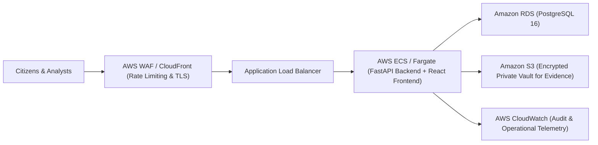

# CYBERSHIELD — Production Deployment & Cloud Guide

## 1. Local & Containerized Deployment

### Docker Compose
CYBERSHIELD includes a production-ready `docker-compose.yml`:
```bash
docker compose up -d --build
```
This initializes:
- `cybershield-db`: PostgreSQL 16 Alpine container with healthchecks.
- `cybershield-backend`: Python 3.11 FastAPI container running Uvicorn on port 8000.
- `cybershield-frontend`: Multi-stage build container served via Nginx on port 3000.

---

## 2. AWS Cloud Architecture (Cost-Conscious & Scalable)



### AWS Implementation Steps
1. **Compute:** Deploy backend and frontend containers to **AWS ECS (Elastic Container Service)** using Fargate or a small EC2 `t4g.small` instance to keep infrastructure costs minimal.
2. **Database:** Deploy **Amazon RDS PostgreSQL** (Single-AZ `db.t4g.micro` for dev, Multi-AZ for production).
3. **Evidence Storage:** Configure an **Amazon S3 Bucket** with:
   - Server-Side Encryption (SSE-KMS)
   - Public Access Blocked strictly
   - Object Lock / Versioning for forensic retention.
4. **Network Security:** Place ECS backend tasks in private subnets with NAT gateway egress; restrict inbound traffic to Application Load Balancer.
5. **Secrets Management:** Store `SECRET_KEY`, database credentials, and API tokens in **AWS Secrets Manager** or AWS Systems Manager Parameter Store.
